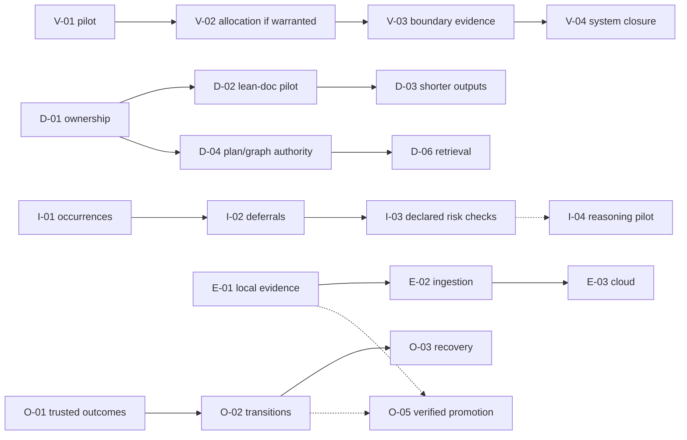

# Personal Skills — Future Feature Map

**Revision:** 2026-10-14 · consolidated concept edition; I-04 pilot clarified  
**Status:** Candidate feature portfolio, **not** an authorized project plan or runtime status tracker.  
**Goal:** Improve system-level verification and safely automate more of delivery, without adding unnecessary stages, documents or agents.

## Start here

This map contains **30 future feature candidates in six families**. It is deliberately compact: choose a feature here, read its concept note, then reevaluate requirements and the current repository before authorizing a scoped plan. Historical detailed proposals are **not required reading** and may be archived; their useful directions have been consolidated into these five notes.

| Concept note | What it answers | Feature families |
|---|---|---|
| [Delivery principles and boundaries](concepts/01-delivery-principles.md) | Who owns each obligation, observation and decision? What safeguards must remain? | All |
| [System verification and test quality](concepts/02-system-verification-and-test-quality.md) | How do we prove composed behavior and keep tests maintainable? | V; Q-01/02 |
| [Documentation and task planning](concepts/03-documentation-and-task-planning.md) | How do we reduce duplicate context and plan useful task boundaries? | D; Q-03/04/05 |
| [Issue knowledge and evidence](concepts/04-issue-knowledge-and-evidence.md) | How do we remember defects, revisit deferrals and retain actual runs? | I; E |
| [Orchestration and sandboxing](concepts/05-orchestration-and-sandboxing.md) | How do we mechanize the flow and safely qualify/promote isolated changes? | O |

**Source-of-truth rule:** Current approved repository plans, tasks, policies and independently reviewed bytes control ongoing work. This map is for *future selection*. A statement that a feature is `CANDIDATE` does not authorize editing its owning skill. Existing completed/source-implemented safeguards are not re-opened as new features.

## Choosing what's next

Use this order of questions: (1) Which material failure or unowned proof would it solve? (2) Can a cheap read-only pilot or disposable experiment establish incremental value? (3) Is the source owned by an active task? (4) Does it introduce a competing source of truth? (5) What independent evidence would show that it worked? Choose one bounded outcome, not a whole family.

| Selection lane | Suggested choice | Why / exit decision |
|---|---|---|
| **Finish current authorized work** | Remaining T-003 children, then T-004/T-005 under their actual dependencies | Establish stable flow and honest installed-behavior qualification; no portfolio additions to active ACs |
| **First independent investigation** | **V-01** | Find consequential system-proof gaps beyond the verification map already present—or conclude a new stage is unnecessary |
| **Parallel foundational design** | **D-01** | Settle who owns facts/guards before shortening skills and templates |
| **Next cost/correctness test** | **D-02** following D-01 | Compare full old-vs-lean task/review lifecycle, including corrections; adopt only if fidelity holds |
| **Opportunistic scoped source change** | **Q-01**, once T-003 owner is clear | Test-asset architectural defects are not detected by merely passing tests |
| **Operational exploratory spikes** | **I-01/I-02** replay; **E-01** local evidence spike | Establish actual recurring issues, stale deferrals and transport feasibility without a platform build |
| **Later optional decision-model pilot** | **I-04** semantic triage benchmark | Compare Jev or another typed model against rules and a cheap LLM on historical findings; no new gate, skill or decision authority |
| **Conditional implementation** | **V-02 → V-03 → V-04**, **D-03/04/07** | Only after matching pilots show material gain; existing plans may be strengthened instead |
| **Later infrastructure** | **O-01/02/03**, **E-02/03**, **O-05** | Mechanize established behavior and eventually qualify isolated candidate merges |

**Current-state caution:** At the last inspected branch commit, T-003.1 was described as accepted in its commit message and the task index included T-003.1–.4. Neither is a substitute for a current, independently evidenced completion check. Re-read the active branch/reviews before selecting a file-editing feature.

## Feature catalog

Posture: **PILOT** = investigate before committing; **CANDIDATE** = valuable bounded idea needing authorization; **CONDITIONAL** = implement only if a smaller result proves necessity; **LATER** = preserve direction, not near-term work. Dependencies shown are decision dependencies unless stated otherwise; a small independent experiment may precede a future full implementation.

### V — System verification

| ID | Desired outcome | Posture | Unlock / boundary |
|---|---|---|---|
| **V-01** | Find missing or redundant cross-task proof, real-boundary oracles and testability prerequisites | **PILOT · next** | Existing approved multi-task plan; assess *delta* from current verification map |
| **V-02** | Give material system flows/invariants an owner, observable oracle and runnable milestone | CONDITIONAL | V-01 shows a real unowned obligation; reconcile in draft planning |
| **V-03** | Prove affected boundaries with targeted baseline and post-change integration checks | CANDIDATE | Known test owner/observable interface; avoid blanket full-suite policy |
| **V-04** | Demonstrate first composed milestone and independent final system closure | CANDIDATE | V-01/02 learning and relevant V-03 evidence; preserve unresolved gaps |
| **V-05** | Use property/state/fault/mutation testing for hard-to-prove critical guarantees | CONDITIONAL | A specific risk defeats cheaper oracles |

### D — Documentation, authority and context

| ID | Desired outcome | Posture | Unlock / boundary |
|---|---|---|---|
| **D-01** | Assign one owner to each rule/fact and clarify prevention vs adversarial verification vs routing | **CANDIDATE · design next** | Read-only role/authority map first; retain preventive safety |
| **D-02** | Validate that lean documents/skills preserve correctness while lowering lifecycle cost | **PILOT** | D-01; complex and small existing tasks, fresh reviewers |
| **D-03** | Make each stage output concise, unique and linked to detailed evidence | CONDITIONAL | D-02 fidelity and cost success; no active task collision |
| **D-04** | Stop plan/JSON graph from restating contracts independently | CONDITIONAL | Normative-source choice and existing consumer review |
| **D-05** | Show accepted/blocked/unknown status and next owner from current evidence | CANDIDATE | Read-only derived view; no reviewer edits to plan |
| **D-06** | Retrieve minimal current context for each role with stable links | CONDITIONAL | D-01 and sufficiently reliable reference/identity graph |
| **D-07** | Mechanically check identities, references, stale revisions and forbidden changes | CANDIDATE | Trusted canonical inputs; cannot self-prove behavior |

### Q — Test quality and planning

| ID | Desired outcome | Posture | Unlock / boundary |
|---|---|---|---|
| **Q-01** | Independently identify material maintainability defects in *changed tests/evals/harnesses* | **CANDIDATE** | Separately authorize after T-003 ownership/scope; preserve byte freshness |
| **Q-02** | Reduce duplicated fixtures and brittle structural tests without losing oracles | CANDIDATE · later | Stable review flow and Q-01 guidance; prove retained coverage |
| **Q-03** | Distinguish good splits, justified keep-whole and honest reasons with adversarial evals | CANDIDATE | Keep implemented boundary-quality P0; fix F0 semantics, test F1 behavior |
| **Q-04** | Settle shared interfaces and dependent proof before separately briefing related tasks | CANDIDATE | Existing planning/verification skills; JIT briefing by default |
| **Q-05** | Elaborate later child briefs progressively and tune splitting using real cost | CONDITIONAL | Observed stale briefs, handoff churn or costly rework |

### I — Issue history and deferrals

| ID | Desired outcome | Posture | Unlock / boundary |
|---|---|---|---|
| **I-01** | Preserve every issue occurrence and connect recurrence/regression to correction cycles | **CANDIDATE · pilot first** | Numbered review/run history; uncertain dedup explicitly labeled |
| **I-02** | Reconsider deferrals when relied-on safeguards or context change | CANDIDATE | Small safe-while / reconsider-when representation; existing coordinator authority |
| **I-03** | Mechanically flag known hazardous combinations and stale assumptions | CONDITIONAL | I-01/02 and validated guarantee/dependency links |
| **I-04** | Evaluate broader-context issue risk and advisory classification of confirmed findings | PILOT · later | Replay real review records against rules and a cheap LLM; measure critical under-triage and cost before any routing integration |

### E — Evidence and observability

| ID | Desired outcome | Posture | Unlock / boundary |
|---|---|---|---|
| **E-01** | Preserve local run evidence without `.git` writes and recover prior evidence | **CANDIDATE · spike first** | Git snapshot portability and permission experiment; no acceptance authority |
| **E-02** | Ingest events from TUI, sandbox, desktop and future controller consistently | CONDITIONAL | E-01 local store; per-worktree ownership and retry semantics |
| **E-03** | Retain authorized evidence in optional remote archive/query store | LATER | E-01/02; real cross-host need and secrets/upload policy |
| **E-04** | Analyze correction loops, repeated failures and end-to-end workflow cost | CANDIDATE · small | I-01 and actual run records; no invented telemetry/dashboard first |

### O — Orchestration and isolation

| ID | Desired outcome | Posture | Unlock / boundary |
|---|---|---|---|
| **O-01** | Admit typed stage outcomes against independently observed facts | CANDIDATE · separate design | Stable review roles and trusted capture/identity |
| **O-02** | Let code control applicable stages, correction routes and dependency release | LATER | O-01, current approved transition contract |
| **O-03** | Retain runnable skill-flow versions and resume interrupted work safely | LATER | O-01/02 and compatible version bundles |
| **O-04** | Correlate actual task, stage, attempt, run and proof events without transcript parsing | CANDIDATE · with E/O | One clear instrumentation owner; no duplicated event authority |
| **O-05** | Implement in isolated clone; independently verify staged candidate; controller alone promotes exact qualified bytes | **LATER** | Repo-specific sandbox/test permissions, independent acceptance, target-drift handling; disposable pilot before platform commitment |

## Dependencies that matter most

Solid arrows indicate a useful typical sequence (some can be independently prototyped); dotted arrows are helpful inputs, **not prerequisites for a disposable experiment**. Q-01 is a separate test-review extension; Q-03/04 can be scheduled when their owning skills are not under active changes. D-04, O-01 and cloud storage do **not** block V-01.

## Updating the map without recreating documentation sprawl

On selecting a feature, record only its **ID, current selection decision, actual owner/source revision, smallest independently checkable outcome, blocking dependency, and pointer to the authorized plan/result**. Detailed ACs, tests, source edits, estimates and runtime logs belong in the selected work package, not this map. Change posture only when evidence or a real decision changes.

When a future proposal overlaps a current task or feature, *reconcile and merge instead of minting another ID*. Revisit size and architecture choices at selection: concept notes preserve the reason and desired outcome, **not** the implementation blueprint.

**Explicitly not separate future work:** reapply the already-shipped initial test-maintenance wording; duplicate current task-local verification design or independent acceptance; invent a second accepted-deferrals authority; add automatic reviewer edits to approved plan bytes; demand full brownfield archaeology; mandate a full E2E/model evaluation for every task; or treat sandboxing as a substitute for review and tested promotion.
